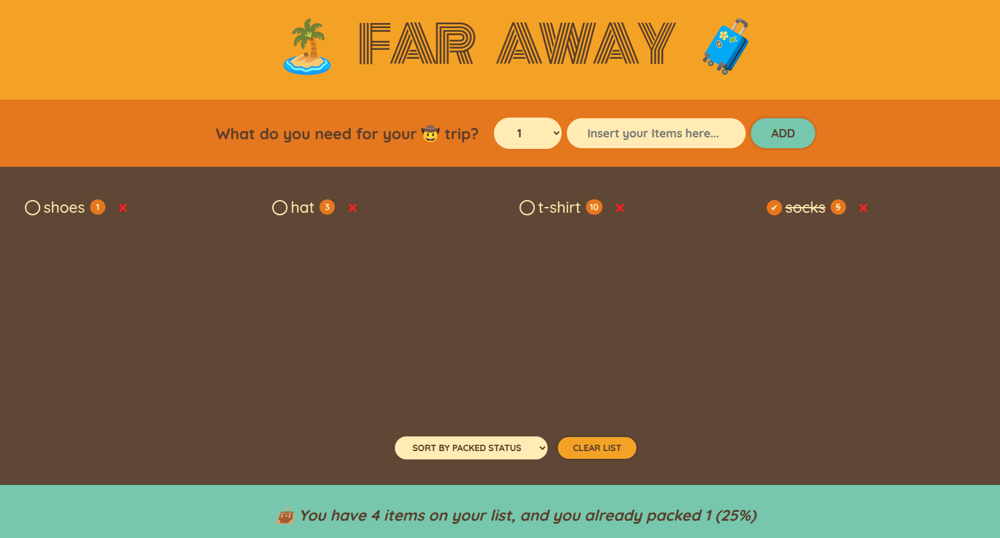

# 🧳 Far Away — Packing List

A packing list application built with **React** and **Vite**

<p align="center">
  
</p>

Far Away helps you organize the items you need for your next trip. This project started as a learning exercise, but I expanded it with my own styling, animations, and implementation choices while practicing React fundamentals.

## ✨ Features

- **Add items** — Add items to your packing list with a custom quantity.
- **Toggle packed status** — Mark items as packed or unmark them using custom checkboxes.
- **Delete items** — Remove individual items from the list.
- **Sort items** — Organize items by input order, description, or packed status.
- **Clear list** — Remove all items from the packing list.
- **Live statistics** — Track the total number of items, packed items, and packing progress.
- **Custom UI and animations** — Personalized styling, hover effects, and CSS transitions.
- **Unique item IDs** — Generate unique identifiers using `crypto.randomUUID()`.

## 🛠️ Built With

- [React](https://react.dev/) — Component-based UI and state management.
- [Vite](https://vite.dev/) — Development server and production build.
- JavaScript (ES6+)
- CSS3 — Custom styling, transitions, and animations.
- HTML5
- [ESLint](https://eslint.org/) — Code linting.
- [Prettier](https://prettier.io/) — Code formatting.

## 🚀 Getting Started

### Prerequisites

- [Node.js](https://nodejs.org/)
- npm

### Installation

1. Clone the repository:

   ```bash
   git clone https://github.com/nwntaspap/Far-Away.git
   ```

2. Navigate to the project directory:

   ```bash
   cd Far-Away
   ```

3. Install the dependencies:

   ```bash
   npm install
   ```

4. Start the development server:

   ```bash
   npm run dev
   ```

5. Open the local URL displayed in your terminal.

## 📜 Available Scripts

| Command                | Description                               |
| ---------------------- | ----------------------------------------- |
| `npm run dev`          | Start the development server              |
| `npm run build`        | Build the application for production      |
| `npm run preview`      | Preview the production build              |
| `npm run lint`         | Check the code with ESLint                |
| `npm run lint:fix`     | Automatically fix supported ESLint issues |
| `npm run format`       | Format files with Prettier                |
| `npm run format:check` | Check code formatting                     |

## 🧠 What I Practiced

- Building reusable React components.
- Passing data and callback functions through props.
- Managing application state with `useState`.
- Updating arrays and objects immutably.
- Handling form submissions and controlled inputs.
- Rendering lists with unique keys.
- Implementing toggle and delete functionality.
- Deriving statistics from existing state.
- Sorting data without mutating the original array.
- Using Vite to configure a modern React development environment.
- Creating custom CSS interactions and animations.

## 🎨 Personal Touches

Rather than following the course implementation line by line, I made my own choices to customize the application:

- Set up the project with **Vite** instead of Create React App.
- Created a component-based structure to separate the UI into reusable pieces.
- Designed custom CSS styling, including hover effects and transitions.
- Added unique IDs with `crypto.randomUUID()`.
- Implemented sorting and list-clearing functionality.
- Customized the packing list interface and checkbox interactions.

## 🎯 Purpose

This project is part of my journey toward becoming a frontend developer. My goal is to strengthen my understanding of React by building practical projects, experimenting with my own ideas, and gradually becoming more independent in writing code.

---
